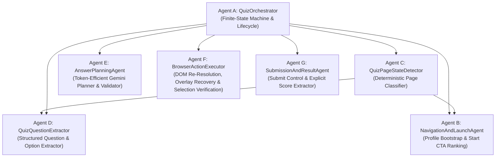
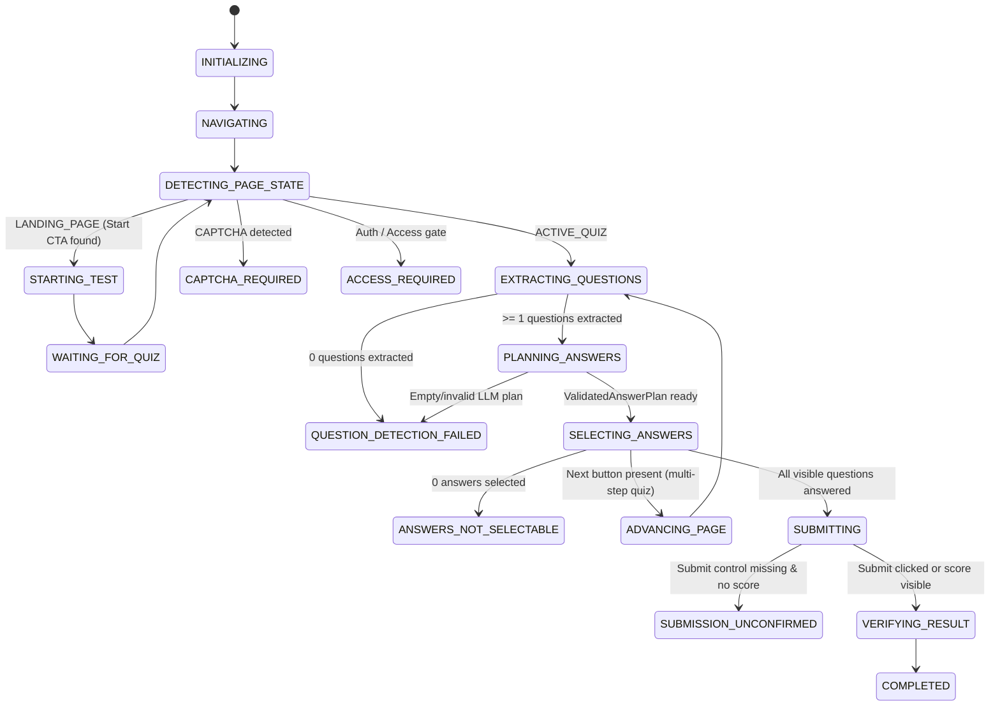

# Browser Automation Agent — State-Aware Multi-Agent Quiz Orchestrator

A modular, state-aware browser automation system built with **Playwright (Chromium)**, **FastAPI**, and **Google Gemini** (`google-genai`). Designed to navigate, classify, extract, plan, execute, and verify public web-based quizzes and tests across diverse page layouts without page-specific hardcoding.

---

## 1. High-Level Architecture Overview

Instead of treating every target URL as an already-opened single-page form, the system uses a **7-agent coordinator + specialist architecture**:



---

## 2. Specialist Agents & Responsibilities

| Agent | Class & Module | Responsibility |
| :--- | :--- | :--- |
| **Agent A** | `QuizOrchestrator` (`src/browser_agent/agents/orchestrator.py`) | Top-level finite-state machine, retry/timeout budgets, structured `ProgressEvent` emission, multi-page loop coordination, and atomic history persistence (`results/agent_history.json` + Firestore). |
| **Agent B** | `NavigationAndLaunchAgent` (`src/browser_agent/agents/navigation_agent.py`) | Fills optional profile fields (`surname`, `name`, `grp`/`group`), ranks start-test CTAs across Ukrainian, Russian, and English (`Почати тест`, `Розпочати тест`, `Пройти тест`, `Начать тест`, `Start quiz`, `Begin test`, `Take the test`), rejects non-start buttons (`Restart`, `Share`, `Login`, `Subscribe`, ` заново`), and verifies post-click DOM transitions. |
| **Agent C** | `QuizPageStateDetector` (`src/browser_agent/agents/state_detector.py`) | Deterministically classifies the current DOM into `LANDING_PAGE`, `ACTIVE_QUIZ`, `LOADING_STATE`, `RESULT_PAGE`, `ACCESS_GATE`, `AUTH_REQUIRED`, `CAPTCHA_REQUIRED`, or `UNKNOWN_PAGE` with explicit confidence and evidence before any LLM call. |
| **Agent D** | `QuizQuestionExtractor` (`src/browser_agent/agents/question_extractor.py`) | Groups answer controls by question container (`fieldset`, `[role=radiogroup]`, `.quiz-question`, heading proximity), extracts radio buttons, checkboxes, `<select>` dropdowns, and custom button/card options, records `locator_hint` metadata, and identifies `next_control_id` and `submit_control_id`. |
| **Agent E** | `AnswerPlanningAgent` (`src/browser_agent/agents/answer_planner.py`) | Enforces the **Zero-Question Gate** (never calls Gemini if 0 questions are extracted), constructs compact structured prompts containing only extracted questions and options, enforces `max_llm_calls` and fingerprint deduplication, and validates all returned `BatchSelection` items against real DOM options. |
| **Agent F** | `BrowserActionExecutor` (`src/browser_agent/agents/action_executor.py`) | Executes validated answer selections one question at a time, re-resolves shifted DOM element IDs via `locator_hint`, dismisses pointer-intercepting overlays (`Escape` + visible close buttons), verifies DOM selection state (`verify_selection`), and emits per-question progress events (`question_started`, `answer_selected`, `answer_selection_failed`). |
| **Agent G** | `SubmissionAndResultAgent` (`src/browser_agent/agents/submission_agent.py`) | Distinguishes `answers_selected`, `submission_attempted`, `submission_confirmed`, `awaiting_manual_submission`, `result_page_captured`, `score_captured`, and `submit_control_not_found`. Extracts explicit scores (`8/10`, `8 з 10`, `8 out of 10`) and never fabricates results. |

---

## 3. Orchestrator Finite-State Machine (`WorkflowState`)



---

## 4. Core Data Schemas (`src/browser_agent/models.py`)

- **`PageClassification`**: `category` (`PageCategory`), `confidence` (`0.0–1.0`), `evidence` (`list[str]`), `recommended_action`, `detected_questions_count`, `start_candidates`.
- **`ExtractedQuestion` & `ExtractedOption`**: `question_id`, `question_number`, `prompt`, `question_type` (`single_choice`, `multiple_choice`, `select_dropdown`), `options` (`option_id`, `element_id`, `text`, `value`, `control_type`, `checked`, `locator_hint`).
- **`ValidatedAnswerPlan` & `ValidatedAnswerAction`**: Validated mapping from each `ExtractedQuestion` to a verified `element_id`, `option_text`, `option_value`, `control_type`, and `locator_hint`.
- **`BatchExecutionResult`**: `results` (`list[QuestionActionResult]`), `answers_selected`, `answers_failed`, `questions_unanswered`.
- **`SubmissionResult`**: `submission_attempted`, `submission_confirmed`, `submit_control_id`, `submit_control_not_found`, `awaiting_manual_submission`, `result_page_captured`, `score_captured`, `score_text`, `test_outcome`, `evidence`.

---

## 5. Structured Progress Event Schema (`ProgressEvent`)

Every lifecycle transition and per-question action emits a `ProgressEvent` stored in `run_record["events"]` and streamed to stdout for live UI rendering:

```json
{
  "event_type": "answer_selected",
  "workflow_state": "SELECTING_ANSWERS",
  "timestamp": "2026-10-27T16:35:00+00:00",
  "message": "Відповідь вибрано: Питання 1/3: 1. Який протокол працює на транспортному рівні моделі OSI? — обрано «TCP»",
  "question_index": 1,
  "total_questions": 3,
  "question_text": "1. Який протокол працює на транспортному рівні моделі OSI?",
  "selected_option": "TCP",
  "status": "selected",
  "metadata": {}
}
```

---

## 6. Token Efficiency Strategy

1. **Zero-Question Gate**: `QuizOrchestrator` and `AnswerPlanningAgent` never invoke Gemini on `LANDING_PAGE`, `LOADING_STATE`, `UNKNOWN_PAGE`, or any DOM state where `len(extraction.questions) == 0`.
2. **Compact Structured Prompts**: Instead of dumping all raw navigation links, footer menus, and full page text into Gemini, `build_structured_questions_prompt()` sends only the extracted questions and their candidate options (`element_id`, `type`, `value`, `text`).
3. **Deduplication & Call Ceiling**: `AnswerPlanningAgent` hashes the extracted question set so identical page states are never sent to Gemini twice, and enforces `MAX_LLM_CALLS` (default `5`).

---

## 7. Security & Public URL Guardrails

All browser sessions enforce strict SSRF and egress protections (`public_url_security.py` and `main.py`):
- Only public `https://` target URLs are permitted (loopback, RFC1918 private networks, link-local, and cloud metadata IPs are blocked at DNS resolution, Playwright route interception, and the local `PublicEgressProxy`).
- Device-scoped history isolation via `X-Device-ID` SHA-256 owner hashing.

---

## 8. Local Development & Testing

```bash
# Activate virtual environment
source .venv/bin/activate

# Run the complete unit, security, regression, and headless Playwright E2E test suite
python -m unittest discover -s tests -v
```

### Supported Quiz Formats & Known Limitations
- **Supported**: Single-page and multi-page HTML quizzes using native `<input type="radio">`, `<input type="checkbox">`, `<select>` dropdowns, ARIA radio/checkbox/option roles, and button/card option groups; start/landing pages requiring profile fields or localized Start CTAs.
- **Known Limitations**: Pages protected by CAPTCHA (`captcha_required`), mandatory login/password walls (`access_required`), or closed `<canvas>`/cross-origin iframe widgets are detected and reported with explicit diagnostic failure states rather than false-positive completions.
