# Browser Automation Agent — Backend API & Multi-Agent Orchestrator

[](https://github.com/Kokos96/browser-agent/actions/workflows/validate.yml)


**Browser Automation Agent** — це серверна мультиагентна система для автономного проходження, аналізу та верифікації інтерактивних веб-тестів, освітніх квізів і веб-форм у реальному безголовому браузері **Playwright Chromium** під керуванням **FastAPI** та великих мовних моделей **Google Gemini** (`google-genai`).

- **Frontend Production (Vercel):** [https://browser-agent-web-nine.vercel.app/](https://browser-agent-web-nine.vercel.app/)
- **Контрольний E2E-стенд (3 питання):** [https://browser-agent-web-nine.vercel.app/test-quiz.html](https://browser-agent-web-nine.vercel.app/test-quiz.html)
- **Швидкий Smoke-стенд (1 питання):** [https://browser-agent-web-nine.vercel.app/agent-test.html](https://browser-agent-web-nine.vercel.app/agent-test.html)
- **Frontend-репозиторій:** [Kokos96/browser-agent-web](https://github.com/Kokos96/browser-agent-web)

---

## Зміст

1. [Ключові можливості системи](#1-ключові-можливості-системи)
2. [Високорівнева системна архітектура](#2-високорівнева-системна-архітектура)
3. [Мультиагентне ядро (7 спеціалізованих агентів)](#3-мультиагентне-ядро-7-спеціалізованих-агентів)
4. [Візуальний огляд роботи системи та інтеграція з Frontend UI](#4-візуальний-огляд-роботи-системи-та-інтеграція-з-frontend-ui)
5. [Структура репозиторію](#5-структура-репозиторію)
6. [Специфікація REST API](#6-специфікація-rest-api)
7. [Безпека, захист від SSRF та життєвий цикл сесій](#7-безпека-захист-від-ssrf-та-життєвий-цикл-сесій)
8. [Швидкий старт та локальний запуск](#8-швидкий-старт-та-локальний-запуск)
9. [Тестування та CI/CD (65 автотестів)](#9-тестування-та-cicd-65-автотестів)
10. [Хмарне розгортання у Google Cloud Run](#10-хмарне-розгортання-у-google-cloud-run)
11. [Перспективи розвитку та перехід на власну локальну LLM (vLLM / Ollama)](#11-перспективи-розвитку-та-перехід-на-власну-локальну-llm-vllm--ollama)

---

## 1. Ключові можливості системи

- **Державно-орієнтований мультиагентний оркестратор (`QuizOrchestrator`):** поділ процесу на 7 спеціалізованих ролей із детермінованим контролем станів (`WorkflowState`), бюджетом кроків та захистом від зациклення.
- **Пакетне планування відповідей (`Batch Answer Planning`):** усі невідповідені питання поточного екрана групуються в єдиний структурований запит до моделі Gemini зі строгою Pydantic JSON-схемою, що зменшує затримку до **6–9 секунд** на тест і заощаджує токени (~892 токени на квіз із 3 питань).
- **Достовірна верифікація результату (Zero Fake Completions):** сесія отримує статус `completed` виключно після підтвердженого вибору відповідей у DOM, надсилання форми та зчитування фінального балу (`3/3`, `100%`).
- **Чесна класифікація зовнішніх бар'єрів:** автоматичне розпізнавання сторінок входу (`blocked_access`), платних підписок і тарифних пейволів (`subscription_required`), CAPTCHA та форм, що потребують ручного підтвердження (`needs_manual_input`).
- **Ешелонований захист від SSRF (`public_url_security.py`):** підтримка будь-яких публічних HTTPS-тестів із попередньою перевіркою DNS та блокуванням приватних мереж RFC1918, `localhost` і хмарних метаданих `169.254.169.254`.
- **Ізоляція історії пристроїв та контроль таймаутів:** криптографічне розділення сесій за `SHA-256(X-Client-Id)`, атомарний запис `results/history.json` через `os.replace()` та автоматична реконсиляція завислих запусків (`MAX_RUN_DURATION_SECONDS = 300`, `STALE_RUN_TIMEOUT_SECONDS = 360`).

---

## 2. Високорівнева системна архітектура

Комплекс поєднує клієнтський веб-додаток на **Vercel**, REST API шлюз **FastAPI** у **Google Cloud Run (`europe-west1`)**, ізольований підпроцес браузерного оркестратора з **Playwright Chromium** та хмарний рушій **Google Gemini API**.

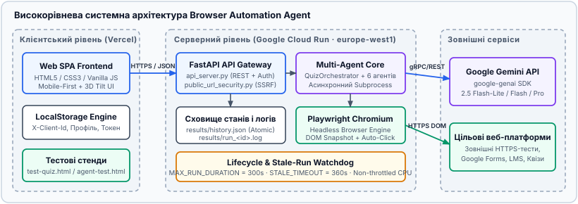

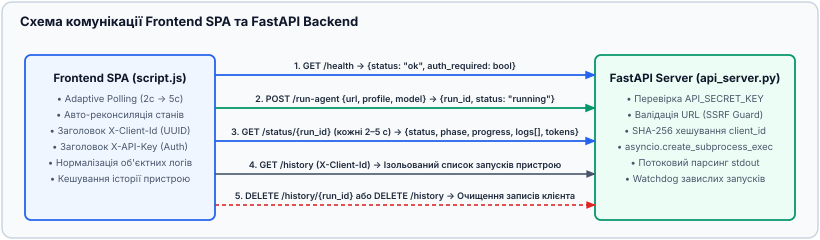

---

## 3. Мультиагентне ядро (7 спеціалізованих агентів)

Замість монолітного скрипта ядро `src/browser_agent/agents/` розділено на 7 спеціалізованих агентів:

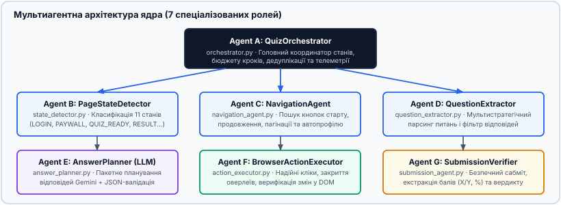

| Агент | Клас та модуль | Призначення в конвеєрі |
|---|---|---|
| **Agent A** | `QuizOrchestrator` (`orchestrator.py`) | Головний координатор автомата станів `WorkflowState`, бюджету кроків, дедуплікації дій та фінальної телеметрії. |
| **Agent B** | `PageStateDetector` (`state_detector.py`) | Класифікація сторінки на 11 станів (`LANDING_PAGE`, `ACTIVE_QUIZ`, `RESULT_PAGE`, `AUTH_REQUIRED`, `ACCESS_GATE` / підписка, `CAPTCHA_REQUIRED`). |
| **Agent C** | `NavigationAgent` (`navigation_agent.py`) | Пошук стартових кнопок (*«Почати тест»*, *«Start»*), пагінації (*«Далі / Next»*) та автозаповнення профілю студента. |
| **Agent D** | `QuestionExtractor` (`question_extractor.py`) | 4-рівнева екстракція питань із DOM (`fieldset`, радіо-групи, ARIA-картки, single-screen) із фільтрацією вже відповідених питань. |
| **Agent E** | `AnswerPlanner` (`answer_planner.py`) | Пакетне планування відповідей через Google Gemini API з валідацією Pydantic JSON-схеми та резервним вибором. |
| **Agent F** | `BrowserActionExecutor` (`action_executor.py`) | Надійне виконання кліків у Playwright із автоматичним закриттям оверлеїв, кліком по `<label>` та JS-fallback. |
| **Agent G** | `SubmissionVerifier` (`submission_agent.py`) | Натискання кнопки фінального сабміту та витягнення підтвердженої оцінки (`3/3`, `%`, статус проходження). |

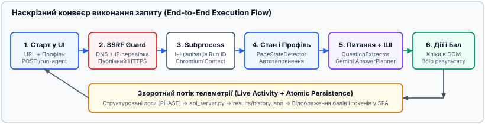

---

## 4. Візуальний огляд роботи системи та інтеграція з Frontend UI

Нижче наведено реальні екрани продуктивного інтерфейсу, які безпосередньо взаємодіють із ендпоінтами цього бекенду (`POST /run-agent`, `GET /status/{run_id}`, `GET /history`, `GET /health`).

### 4.1. Запуск сесії, KPI-метрики та покроковий прогрес (Live Activity)

При запуску тесту фронтенд передає цільовий URL, дані профілю студента та обрану модель Gemini у `POST /run-agent`. Під час виконання бекенд транслює поточну фазу (`starting` → `opening_url` → `preparing_profile` → `analyzing_questions` → `selecting_answers` → `submitting`) та прогрес по кожному питанню:

| Форма запуску тесту та вибір моделі | KPI-картки та останні запуски | Живий моніторинг 6 етапів (`Live Activity`) |
|---|---|---|
| 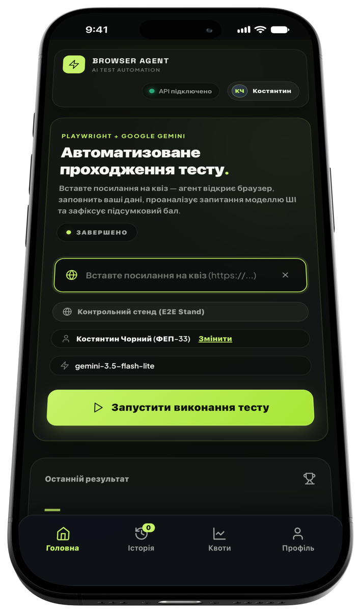 | 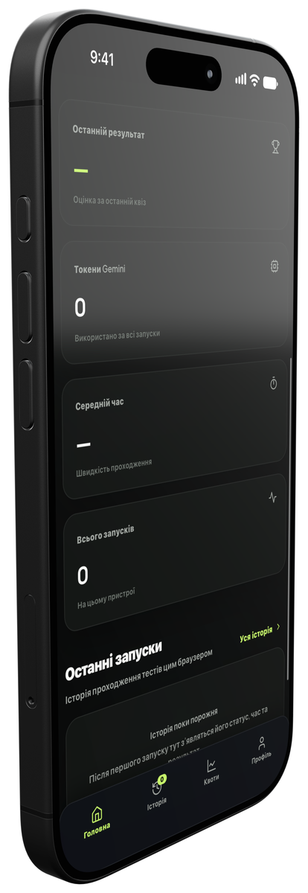 | 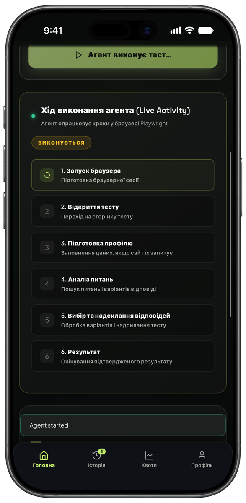 |

### 4.2. Історія сесій, детальний звіт запуску та профіль студента

Після завершення підпроцесу метод `save_history()` атомарно фіксує результат у `results/history.json`, а повний лог зберігається у `results/run_<run_id>.log`. На скриншотах показано реальний запуск `af7e39f59aa04753af67e8d3fe753ea9` (тривалість **6 с**, розпізнано **3** питання, вибрано **3/3**, результат **3/3**, витрачено **892 токени Gemini**: запит 560, відповідь 332):

| Історія запусків (`GET /history`) | Повний звіт запуску (`GET /status/{id}`) | Налаштування профілю та Cloud Run |
|---|---|---|
| 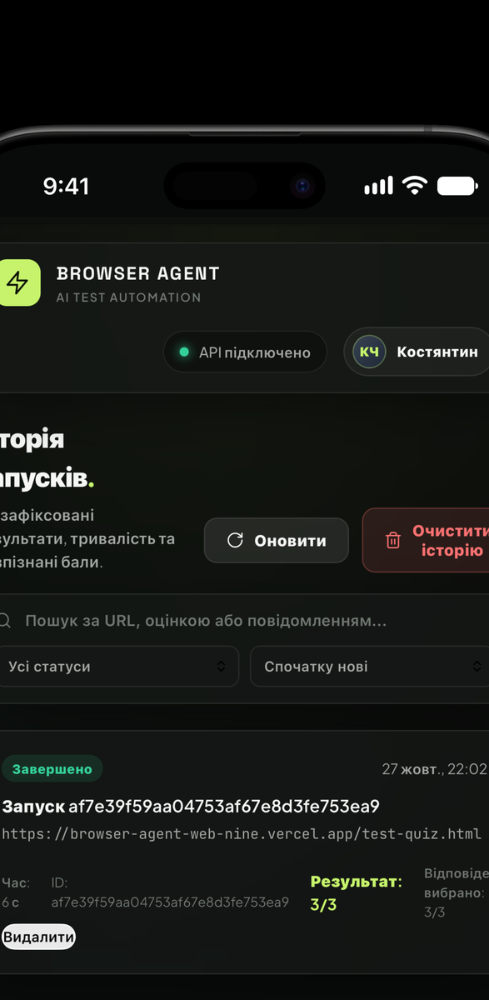 | 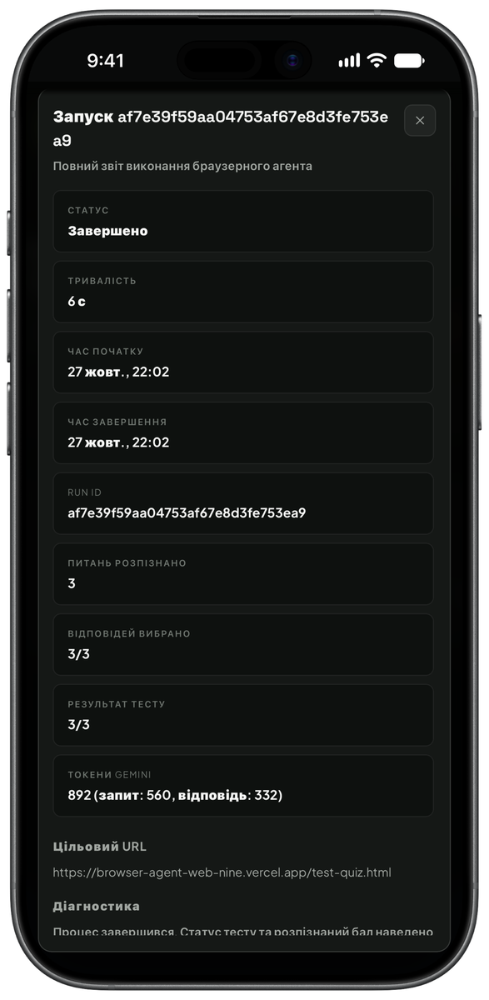 | 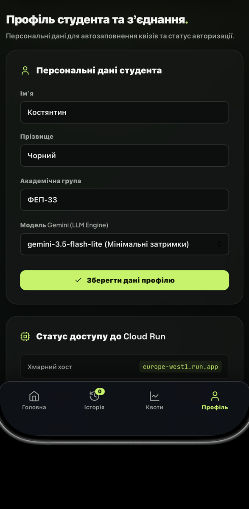 |

### 4.3. Телеметрія квот та аналітика Google Gemini Inference Engine

Бекенд підраховує точну кількість вхідних (`prompt_tokens`) і вихідних (`candidates_tokens`) токенів для кожного виклику SDK `google-genai`, що дозволяє будувати 7-денні графіки активності та розподілу статусів:

| Агреговані метрики токенів Gemini | 7-денна активність та конфігурація Cloud Run |
|---|---|
| 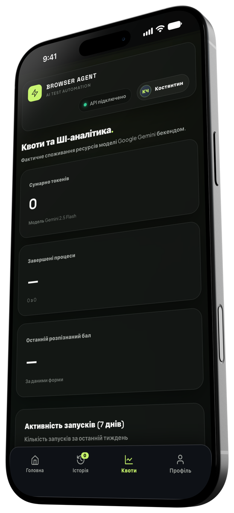 | 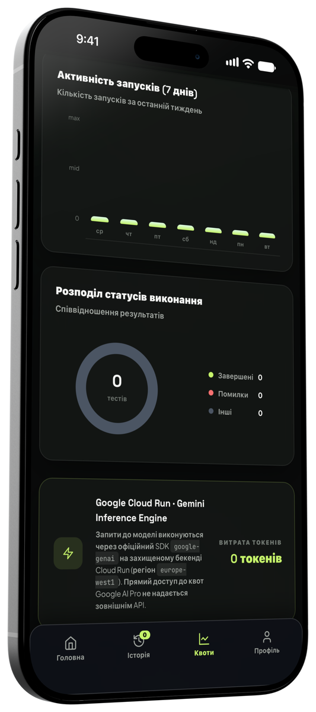 |

---

## 5. Структура репозиторію

```text
browser-agent/
├── api_server.py                        # FastAPI REST-сервер, авторизація, підпроцеси, реконсиляція історії
├── public_url_security.py               # Захист від SSRF: перевірка HTTPS, DNS-резолвінг та фільтрація IP
├── main.py                              # CLI-точка входу підпроцесу браузерного агента
├── Dockerfile                           # Контейнер mcr.microsoft.com/playwright/python:v1.63.0-noble
├── requirements.txt                     # Залежності Python
├── pyproject.toml                       # Метадані пакета та конфігурація pytest/ruff
├── DEPLOYMENT.md                        # Регламент розгортання у Google Cloud Run та відкату ревізій
├── src/browser_agent/
│   ├── config.py                        # Конфігурація середовища, моделей Gemini та тайм-аутів
│   ├── models.py / schemas.py           # Pydantic v2 моделі станів, питань, планів та підсумкового звіту
│   ├── browser.py                       # Керування Playwright Chromium, DOM-інспекція та заповнення профілю
│   ├── llm.py / prompts.py              # Клієнт google-genai SDK, облік токенів та системні промпти
│   ├── agent.py                         # Фасад BrowserAgent та атомарне збереження історії
│   └── agents/                          # Мультиагентне ядро (7 спеціалізованих агентів)
│       ├── orchestrator.py              # Agent A: QuizOrchestrator
│       ├── state_detector.py            # Agent B: PageStateDetector
│       ├── navigation_agent.py          # Agent C: NavigationAgent
│       ├── question_extractor.py        # Agent D: QuestionExtractor
│       ├── answer_planner.py            # Agent E: AnswerPlanner
│       ├── action_executor.py           # Agent F: BrowserActionExecutor
│       └── submission_agent.py          # Agent G: SubmissionVerifier
├── docs/
│   ├── images/                          # 8 скриншотів продуктивного інтерфейсу
│   └── diagrams/                        # 18 векторних архітектурних діаграм (.svg)
└── tests/                               # 65 модульних та інтеграційних тестів
```

---

## 6. Специфікація REST API

| Метод | Ендпоінт | Призначення | Основні поля відповіді |
|---|---|---|---|
| `GET` | `/health` | Перевірка доступності сервера та потреби в API-ключі | `{"status": "ok", "auth_required": true}` |
| `POST` | `/run-agent` | Валідація URL (SSRF Guard) та старт асинхронного підпроцесу | `{"run_id": "<hex>", "status": "running", "phase": "starting"}` |
| `GET` | `/status/{run_id}` | Оперативний статус, поточна фаза, прогрес питань, логи та токени | `{"status", "phase", "progress", "score", "logs", "gemini_tokens"}` |
| `GET` | `/history` | Список запусків поточного пристрою (за хешем `X-Client-Id`) | `[HistoryEntry, ...]` |
| `DELETE` | `/history/{run_id}` | Видалення конкретного запису історії клієнта | `{"status": "deleted", "run_id": "..."}` |
| `DELETE` | `/history` | Очищення всієї завершеної історії поточного пристрою | `{"status": "cleared", "deleted_count": N}` |

---

## 7. Безпека, захист від SSRF та життєвий цикл сесій

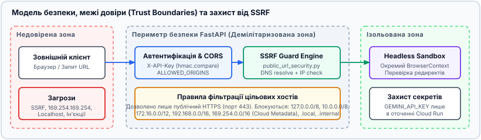

1. **Захист від SSRF (`public_url_security.py`):** дозволяються лише публічні `https://` адреси (або явно дозволені локальні стенди під час E2E-тестів). Перед відкриттям сторінки у Chromium кожен хост резолвиться через `socket.getaddrinfo()`, і всі отримані IPv4/IPv6 адреси перевіряються модулем `ipaddress`. Будь-які приватні мережі (`10.0.0.0/8`, `172.16.0.0/12`, `192.168.0.0/16`), loopback (`127.0.0.0/8`, `::1`) та link-local метадані хмари (`169.254.169.254`) негайно блокуються з кодом `400 Bad Request`.
2. **Обмеження життєвого циклу (`Lifecycle Watchdog`):** максимальна тривалість роботи агента обмежена `MAX_RUN_DURATION_SECONDS = 300`, а фоновий механізм `reconcile_stale_runs()` автоматично переводить сирітські сесії старше `360 с` у термінальний статус.

---

## 8. Швидкий старт та локальний запуск

```bash
# 1. Клонування репозиторію та створення віртуального середовища
git clone https://github.com/Kokos96/browser-agent.git
cd browser-agent
python3 -m venv .venv
source .venv/bin/activate

# 2. Встановлення залежностей та браузера Chromium
pip install -r requirements.txt
python -m playwright install --with-deps chromium

# 3. Налаштування змінних середовища
export GEMINI_API_KEY="ваш_ключ_gemini"
export API_SECRET_KEY="необов_язковий_секретний_ключ_api"

# 4. Запуск FastAPI сервера на порту 8080
uvicorn api_server:app --host 0.0.0.0 --port 8080 --reload
```

---

## 9. Тестування та CI/CD (65 автотестів)

```bash
# Компіляція всіх модулів та запуск повного набору з 65 тестів
python -m compileall -q api_server.py main.py public_url_security.py src/browser_agent tests
python -m unittest discover -s tests -v
```

Усі 65 тестів (`test_multi_agent_orchestrator.py`, `test_public_url_security.py`, `test_run_timeout.py`, `test_history_isolation.py`, `test_agent_fixes.py`) автоматично виконуються у GitHub Actions при кожному `push` та `pull_request`.

---

## 10. Хмарне розгортання у Google Cloud Run

> **Важливо:** Оскільки `api_server.py` запускає підпроцес агента асинхронно після повернення HTTP-відповіді `POST /run-agent`, сервіс Cloud Run **обов'язково має розгортатися з прапорцем `--no-cpu-throttling`** (CPU always allocated).

```bash
gcloud run deploy browser-agent-api   --source .   --region europe-west1   --platform managed   --allow-unauthenticated   --no-cpu-throttling   --memory 2Gi   --cpu 2   --timeout 360   --set-env-vars="GEMINI_MODEL=gemini-2.5-flash-lite,MAX_RUN_DURATION_SECONDS=300,STALE_RUN_TIMEOUT_SECONDS=360"
```

---

## 11. Перспективи розвитку та перехід на власну локальну LLM (vLLM / Ollama)

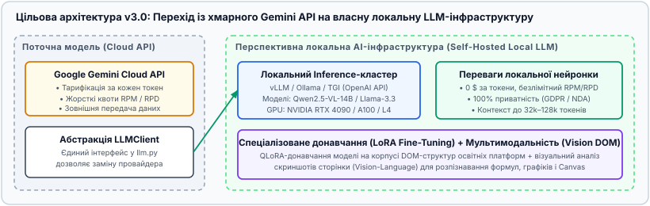

Архітектура класу `LLMClient` (`src/browser_agent/llm.py`) спроєктована для безшовної міграції з хмарного Google Gemini API на **власну локально розгорнуту нейромережу (Self-Hosted Local LLM)**:

- **Локальний сервер інференсу:** підключення **vLLM**, **Ollama** або **TGI** через сумісний OpenAI-ендпоінт (`/v1/chat/completions`) із моделями **Qwen2.5-VL-14B-Instruct**, **Llama-3.3-70B** або **DeepSeek-R1-Distill**.
- **Нульова вартість токенів і відсутність квот RPM/RPD:** повна ліквідація помилок `429 RESOURCE_EXHAUSTED` при масовому паралельному тестуванні.
- **100% локальна приватність даних:** DOM-зрізи внутрішніх університетських і корпоративних платформ не залишають локального контуру.
- **Граматичне JSON-декодування та LoRA Fine-Tuning:** гарантований 100% валідний JSON за схемою Pydantic (`Guided Decoding`) та донавчання власного QLoRA-адаптера на накопичених логах проходження DOM-форм.
