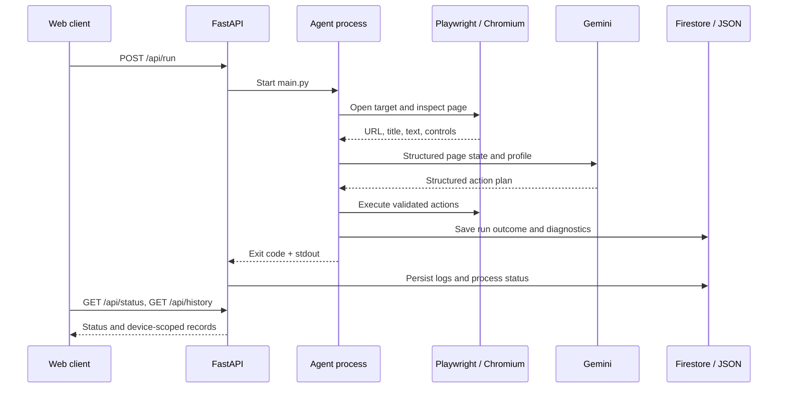

# Architecture

## Components

- **Web client** — the separate frontend repository; sends authorized requests to the API.
- **FastAPI service** — `api_server.py`; validates requests, starts a worker process, exposes status and history endpoints.
- **Worker entry point** — `main.py`; initializes Playwright and converts an explicit failed run into a non-zero process exit code.
- **Browser agent package** — `src/browser_agent/`; inspects page state, performs deterministic profile bootstrap, asks Gemini for a structured plan, executes supported browser actions, and records diagnostics.
- **History storage** — Firestore when `GOOGLE_CLOUD_PROJECT` is configured; local JSON is retained as a fallback/backup path.
- **Run artifacts** — `results/` and `screenshots/`; generated locally and intentionally excluded from version control.

## Run lifecycle

## Outcome semantics

A process exit code describes whether the worker reported success or failure. It does **not** by itself prove that a test was passed.

- `status`: lifecycle state of the worker/run (for example `running`, `completed`, or `error`).
- `test_outcome`: what the agent could verify about the target test (for example `test_content_not_loaded`, `awaiting_manual_submission`, `result_page_captured`, or `score_captured`).
- `score`: populated only when the configured result parser detects a visible score.

A target page that fails to load enough interactive content is recorded as an error with a short diagnostic excerpt, and the worker exits non-zero. The API stores the process exit code and uses it to synchronize the status shown by the status endpoint and history record.

## Current constraints

- The API worker launcher currently allows only one active browser process at a time.
- The current API token is a shared demo credential, not a complete public multi-user identity system. Do not distribute it as if it were production authentication.
- Per-device data isolation depends on a random per-browser device token sent in `X-Device-Token`.
- A captured result page is evidence of a page response; a numeric score is recorded only when the configured score pattern is detected.
